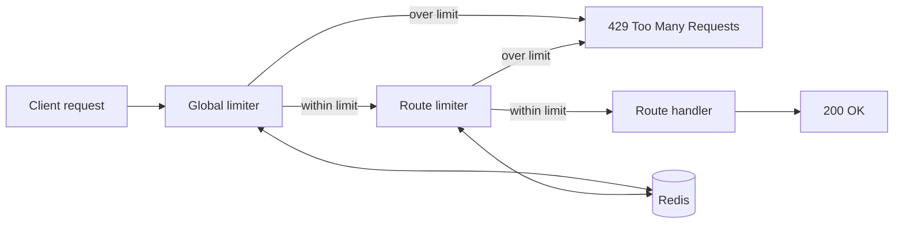

# Rate Limiter Service

A small service that stops users from sending too many requests to an API. It supports 3 different rate limiting algorithms, and each route can pick the one that suits it.

## What problem does it solve?
If one user (or a bot) sends thousands of requests, the API becomes slow for everyone. A rate limiter acts like a bouncer at a club door. It lets people in up to a limit, and tells everyone else "come back later" (HTTP 429).

## Features
- 3 algorithms: Fixed Window, Token Bucket, Sliding Window
- Rules are kept in one config file, so limits can be changed without touching the logic
- A loose global limit plus strict limits on sensitive routes (like login)
- Atomic checks using Redis Lua scripts, so two requests at the same time cannot cheat the limit
- Stats endpoint showing allowed vs blocked requests for each rule
- Automated tests for all 3 algorithms
- Runs with one command using Docker Compose

## Tech Stack
Node.js, Express.js, Redis, Docker, Docker Compose, Node's built-in test runner

## How it works


Every request passes through the global limiter first, then the limiter of its own route. Counters live in Redis, so the numbers stay correct even if the server restarts.

## The 3 algorithms
| | Fixed Window | Token Bucket | Sliding Window |
|---|---|---|---|
| Simple idea | Count requests in each minute, reset at the end | A bucket of tokens that refills slowly | Count requests in the last 60 seconds, counted from right now |
| Boundary loophole | Yes (can send 2x the limit around the reset) | No | No |
| Allows bursts | Accidentally | Yes, on purpose | Up to the limit |
| Memory per user | 1 number | 2 numbers | 1 entry per request |
| Best for | Simple, rough limits | APIs that need bursts but smooth traffic | Strict limits like login |

## Rules used in this project
Defined in `src/config/limits.js`:

| Rule | Algorithm | Limit |
|---|---|---|
| global | Sliding Window | 100 requests per 60 seconds |
| login | Sliding Window | 5 requests per 60 seconds |
| search | Token Bucket | 20 tokens, refills 5 per second |
| upload | Fixed Window | 10 requests per hour |

## API routes
| Method | Route | Limited by | What it does |
|---|---|---|---|
| GET | /health | nothing | Checks the server is running |
| GET | /stats | nothing | Shows allowed and blocked counts per rule |
| DELETE | /stats | nothing | Resets the counts |
| POST | /login | global + login | Demo route with a strict limit |
| GET | /search | global + search | Demo route that allows bursts |
| POST | /upload | global + upload | Demo route with an hourly cap |
| GET | / | global | Home route |

When a user is blocked, the server replies with status `429`. Token Bucket and Sliding Window also send `X-RateLimit-Remaining` and `Retry-After` headers.

## Run with Docker (easiest)
```bash
docker compose up --build
```

The app runs at `http://localhost:3000`. Try `GET /stats`.

If port 6379 is already used by another Redis, stop that one first.

## Run without Docker
1. Start Redis:
```bash
   docker run -d --name my-redis -p 6379:6379 redis
```
2. Install libraries:
```bash
   npm install
```
3. Copy `.env.example` to `.env`
4. Start the server:
```bash
   npm start
```

## Run the tests

Redis must be running on port 6379.

```bash
npm test
```

The tests use Redis database 1, so your real data in database 0 is never touched.

## Project structure
```
src/
  app.js                  routes and limiters
  server.js               starts the server
  redis.js                Redis connection
  config/limits.js        all rate limit rules
  middleware/
    fixedWindow.js        Fixed Window algorithm
    tokenBucket.js        Token Bucket algorithm
    slidingWindow.js      Sliding Window algorithm
    rateLimit.js          picks the algorithm and adds stats
tests/
  limiter.test.js         tests for all 3 algorithms
Dockerfile
docker-compose.yml
```

## Design decisions
- **Atomic Lua scripts:** Token Bucket and Sliding Window read, calculate, and write inside Redis in one step. Without this, two requests at the same millisecond could both slip through.
- **Increment first, then compare:** Fixed Window adds 1 and checks the number it gets back. Checking first and adding later lets one extra request through. My tests caught this bug.
- **Fail open:** if Redis goes down, requests are allowed instead of blocked, so a Redis problem does not take the whole API down.
- **Config-driven rules:** changing an algorithm for a route is a one-word change in the config file.
- **Stats wrapper:** counting is done in one wrapper function, so every algorithm gets stats without changing its own code.
- **Separate counters per rule:** each rule has its own Redis key, so a user's login attempts never mix with their search requests.

